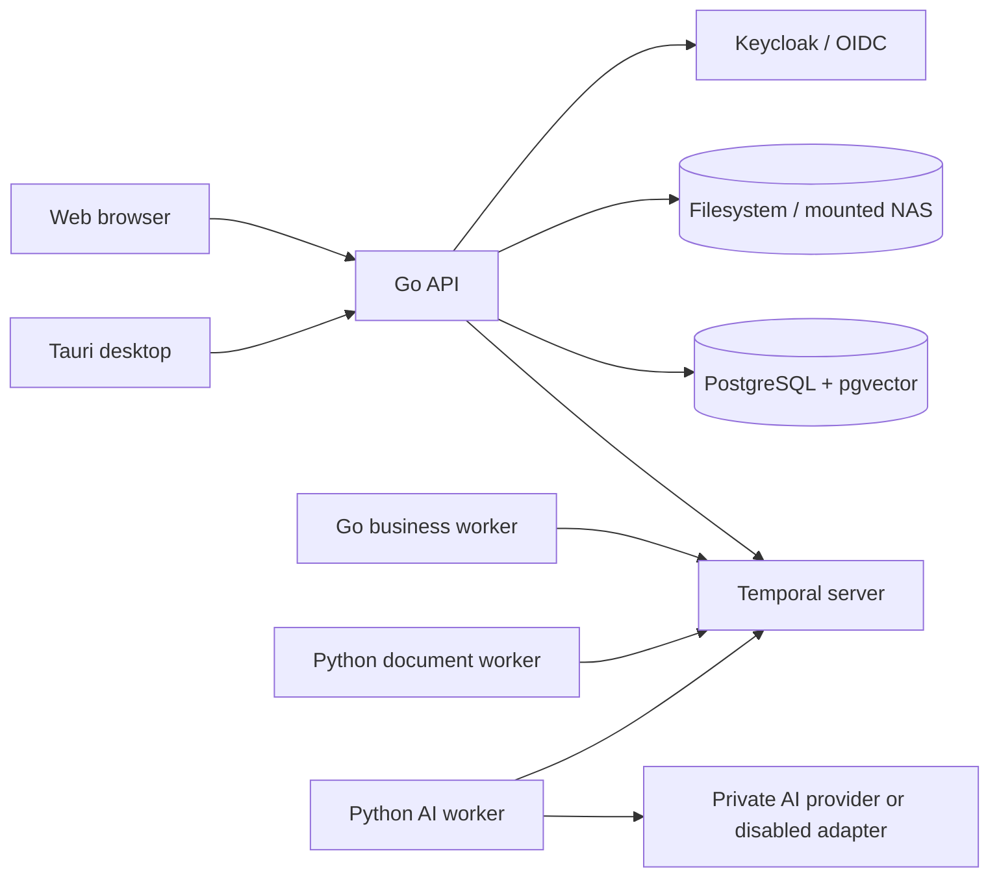
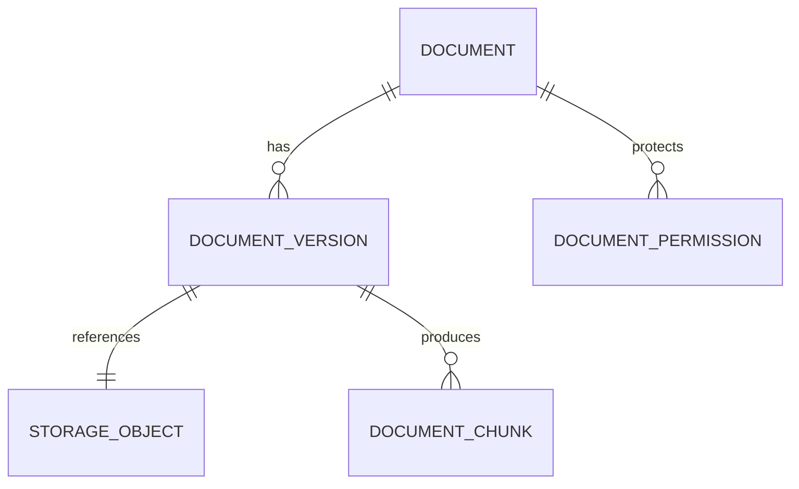
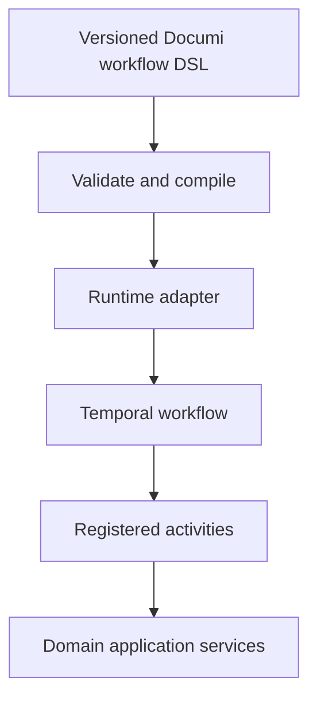
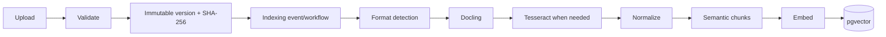
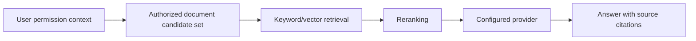

# Documi architecture

Status: implemented bootstrap plus local document persistence and server persistence foundations. Last updated: 2026-08-27.

## 1. Product vision

Documi is an open-source, self-hosted business operations platform joining versioned documents, structured company data, forms, human work, durable automation, authorization, auditing, integrations, and private AI. AI supports the business system; it is not the system's center. A company must be able to operate Documi entirely on infrastructure it controls, including in an air-gapped environment.

The first production journey is an invoice moving from upload through immutable storage, parsing, extraction, approval, archival, audit, and later permission-aware retrieval. The bootstrap creates boundaries that make that slice straightforward; it does not pretend to implement it.

## 2. Product non-goals

The bootstrap does not provide production invoice automation, offline multi-master synchronization, mobile apps, collaborative Office editing, a plugin marketplace, a custom OCR or LLM runtime, a custom authentication protocol, or a custom distributed object store. Kubernetes, Kafka, Elasticsearch, Redis, GraphQL, a service mesh, and a separate vector database are not development prerequisites.

## 3. Architectural principles

- Build a domain-oriented modular monolith before considering microservices.
- Make business records immutable by version and important history append-only.
- Put authorization before access, including before vector or keyword retrieval.
- Use explicit cross-language contracts and generate language bindings later.
- Keep replaceable product requirements behind small, owning-domain interfaces.
- Share product behavior between browser and desktop while isolating platform capabilities.
- Prefer boring, inspectable infrastructure that a small team can operate.
- Assume external networks are unavailable; outbound integrations are optional adapters.

## 4. Technology stack

| Area | Choice |
| --- | --- |
| Web | React, TypeScript, Vite, Tailwind CSS, pnpm workspaces |
| Native documents | Tiptap behind the `native` editor provider |
| Desktop | Tauri v2, shared React UI, Rust for native integration |
| Core | Go modular monolith, REST initially |
| AI/document processing | Python, `uv`, Docling/Tesseract integrations later |
| Canonical server data | PostgreSQL with pgvector |
| Durable workflows | Temporal |
| Company authentication | Keycloak through OIDC abstraction |
| Storage | local or OS-mounted filesystem; S3-compatible later |
| Local AI | provider adapters for Ollama/llama.cpp and disabled mode |

## 5. Repository map

```text
apps/                 web and desktop platform entry points
packages/             shared React shell, UI, editor, API/contracts, workflow UI, config
services/core/        Go API, Temporal worker, migration executable, domain/platform code
services/ai/          one Python project with multiple worker entry points
contracts/            authoritative OpenAPI, event, workflow, plugin, and AI schemas
database/             SQL migrations plus documented seed/fixture conventions
plugins/              built-in and example extension conventions (not a marketplace)
deployments/          Compose, Keycloak, Temporal, air-gap, and future Kubernetes notes
tests/                 cross-process integration, end-to-end, security, and fixtures
docs/                  ADRs and focused engineering/product/security documentation
scripts/               transparent root automation
.github/               CI and contribution automation
```

Directories contain an implementation or a README explaining ownership; placeholder directories are not ornamental.

## 6. Runtime processes



The Go executables share one module. The Python workers share one package and image. Additional processes require an operational or isolation reason, not merely a domain name.

## 7. Domain model

Long-term entities are grouped as follows. Migration `000002` now establishes the document, identity, hierarchy, authorization, version, audit, idempotency, editor-session, and WOPI-lock tables; application repositories are introduced in vertical slices:

```text
organizations, users, groups, memberships
workspaces, folders
documents, document_versions, document_metadata, document_permissions, document_links
storage_objects
collections, collection_fields, collection_records
forms, form_submissions
workflows, workflow_versions, workflow_runs, workflow_steps
tasks, approvals
connections, secrets
ai_models, ai_providers
document_chunks, embeddings
audit_events, notifications, webhooks
```

The intended Go domain modules are `auth`, `organizations`, `users`, `groups`, `workspaces`, `folders`, `documents`, `storage`, `permissions`, `collections`, `forms`, `workflows`, `tasks`, `approvals`, `connectors`, `audit`, `events`, `search`, `ai`, `secrets`, and `notifications`. Modules are added when behavior exists, not as empty packages.

## 8. Frontend architecture

`apps/web` and `apps/desktop` are platform bootstraps. `packages/app-shell` owns navigation and product feature composition for Home, Documents, Data, Forms, Tasks, Automations, AI, Integrations, and Settings. `packages/ui` owns accessible primitives and design tokens. `packages/editor`, `workflow-designer`, `api-client`, `shared-types`, and `config` own their named reusable concerns.

Platform-specific filesystem, update, and native-dialog functions implement a platform interface. Shared feature code never calls Tauri APIs directly. Tailwind scans shared package source; assets and fonts are bundled locally.

## 9. Go backend architecture

`services/core/cmd/{api,worker,migrate}` are composition roots. Domain behavior lives in `internal/modules/<domain>` with interfaces beside the domain that owns them. `internal/platform` contains config, database, HTTP plumbing, logging, telemetry, Temporal integration, auth adapters, crypto, and shutdown mechanics.

HTTP handlers translate protocols, call application services, and translate results. They do not contain business rules. Infrastructure implementations depend inward on domain interfaces. Package-level hidden mutable state is avoided.

## 10. Python AI architecture

`services/ai/src/documi_ai` contains worker entry points and bounded packages for ingestion, parsing, OCR, normalization, chunking, embeddings, retrieval, reranking, extraction, classification, providers, security, contracts, configuration, and observability. Initially the document and AI workers expose health/config validation and a no-op execution loop. Heavy model libraries and model downloads are deliberately absent from bootstrap installs.

Provider protocols accept product-level requests and return product-level responses. Vendor payloads do not leak into workflow or domain contracts.

## 11. Database architecture

PostgreSQL is the canonical database in server workspaces. `pgvector` stores embeddings in the same authorization and transaction boundary as document metadata. Versioned, forward SQL lives in `database/migrations`; the migration executable records applied versions. Tests use isolated databases when persistence behavior is introduced.

SQLite is the implemented local-document metadata store and is not a replica of a live server workspace. Native content stays in application-controlled files. PostgreSQL migration `000002` is the server schema; its HTTP repositories are not yet composed into the API. Application services must not assume PostgreSQL-specific behavior outside repository implementations.

## 12. Document and version architecture



A document is the stable business identity; each content change creates a new immutable version. A version records document/version IDs, provider and storage key, SHA-256, byte size, MIME type, creator, and timestamps. PostgreSQL stores metadata, never ordinary document bytes. The storage provider stores bytes. Corrections create new versions rather than overwriting prior records.

Documents also select an editor through a capability-based provider boundary. The Documents domain does not depend on Tiptap, Collabora, ONLYOFFICE, LibreOffice, or Google. It remains authoritative for permission, bytes, versions, metadata, and audit. Managed content and external references are explicitly different storage modes. See [Document editor architecture](docs/architecture/document-editors.md) and [ADR 0011](docs/adr/0011-document-editor-provider-architecture.md).

## 13. Storage abstraction

The documents/storage boundary owns a small provider contract with `Put`, `Get`, `Delete`, `Move`, and `Exists` operations plus typed metadata/errors. Local filesystem and mounted-filesystem providers are initial implementations: both use paths managed by the operating system. S3-compatible storage is deferred. Keys are validated and cannot escape the configured root; deleting business records is policy-controlled above the byte-store adapter.

## 14. Event architecture

The canonical envelope schema is in `contracts/events` and contains event ID/type/time, organization, workspace, actor and resource context, schema version, and payload. Domain changes and their outbox event will eventually commit atomically in PostgreSQL. Consumers must be idempotent. Event names describe completed facts, such as `document.created`; payload evolution is versioned.

## 15. Workflow and Temporal architecture



The public Documi workflow definition is declarative and independent of Temporal history formats. Definitions, activities, worker registration, and runtime client wiring remain separate. Human tasks and approvals wait durably in Temporal; ordinary background jobs are not substitutes. Workflow code must remain deterministic and activities must be retry-safe.

## 16. AI provider architecture

Product-facing provider capabilities are embedding, generation, structured generation, and health/model discovery as needed. Adapters are planned for Ollama, llama.cpp, vLLM, OpenAI-compatible endpoints, custom HTTP, and a disabled provider. Configuration selects a provider; no module hard-codes one. Model license acceptance and distribution remain separate from Documi licensing. Weights are never committed or automatically downloaded.

## 17. RAG ingestion architecture



Chunks carry organization, workspace, document and version IDs; page/heading/section; offsets and text; content hash; metadata; and permission-filtering attributes. Every derived artifact is tied to an immutable source version and can be rebuilt.

## 18. RAG query architecture



Authorization is applied in the database query that selects candidates, not after retrieval. Retrieval results include stable version/page/offset provenance. Citation correctness is a product capability and is tested independently from answer fluency.

## 19. Permission and security model

Resources inherit through Organization → Workspace → Folder → Document. Roles eventually include Owner, Admin, Manager, Editor, Contributor, Viewer, and Guest, with explicit ACL grants/denies governed by a documented precedence model. Every request carries authenticated subject and organization/workspace context. Authorization belongs in domain policy services and repository query constraints, not UI visibility alone.

Input is validated at trust boundaries. Storage keys are opaque. Downloads are authorized and audited. Service-to-service identities receive least privilege. Security tests specifically cover cross-tenant access and retrieval filtering.

## 20. Audit architecture

Login; document open/download/create/update/delete; permission changes; AI queries; workflow starts/approvals/rejections; and record creates/updates are eventually appended to `audit_events`. Application code never updates or deletes audit history. Entries capture actor, action, target, scope, timestamp, outcome, request correlation, and safe metadata. Sensitive content and secrets are excluded. Database-level immutability enforcement is considered when the schema is introduced.

## 21. Secrets architecture

Environment variables provide bootstrap process configuration. Connection credentials and integration secrets will use an encrypted secret-store abstraction, with ciphertext and key metadata separate from external master-key material. Secrets are redacted from logs, events, audit metadata, API responses, and diagnostics. Rotation and access auditing are required before production connector credentials are stored.

## 22. Local desktop architecture

```text
Documi Desktop
├── Tauri v2 + shared React shell
├── SQLite + sqlite-vec (later)
├── local filesystem
└── Ollama / llama.cpp adapter (later)
```

A purely local workspace needs no server. Fixed Tauri commands initialize one device-owner workspace, persist document/version/audit metadata in bundled SQLite, and store immutable native content beneath the Tauri application-data directory. React uses a shared `DocumentGateway` and never supplies a path or storage key. Local Workspace is an explicit workspace kind and is not automatically synchronized with server state.

Desktop-only Office integration stays behind the shared app-shell platform interface. The Tauri `check_libreoffice` command performs fixed detection only. Future open/save-back uses controlled working copies and the Documents service; React cannot launch arbitrary commands or see internal server storage paths.

## 23. Server architecture

Browser or desktop clients call the Go API. PostgreSQL/pgvector is canonical; Temporal coordinates durable work; Keycloak authenticates through OIDC; Go and Python workers execute activities; company-controlled storage retains bytes; configured private AI performs optional inference. Reverse proxy/TLS and production secret management are deployment responsibilities documented before first release.

## 24. Air-gapped architecture

With `AIR_GAPPED=true`, runtime behavior makes no required outbound calls. Telemetry is disabled, application assets/fonts are local, AI model download is manual, providers requiring external endpoints are rejected by configuration, and integrations remain disabled until an administrator supplies reachable internal endpoints. Release artifacts will eventually include image and dependency manifests plus offline installation guidance.

Google editor providers are rejected server-side in air-gapped mode. Native editing remains available. Collabora, ONLYOFFICE, LibreOffice Desktop, and future LibreOffice conversion may operate when deployed wholly inside the private network; none is a required dependency.

## 25. API principles

REST endpoints are versioned beneath `/api/v1`. OpenAPI is the source contract. Resources use stable opaque IDs, ISO-8601 UTC timestamps, consistent problem responses, bounded pagination, idempotency keys for retryable mutations, and explicit concurrency/version semantics. Health is liveness; readiness verifies dependencies required to serve. Authentication is abstracted from Keycloak-specific claims.

## 26. First production vertical slice

The next milestone implements: authenticate → choose workspace → upload invoice PDF → persist bytes → create document and version metadata → audit → start durable ingestion → parse/OCR → chunk/embed → extract invoice record → create approval → approve/reject → update/archive → permission-aware search with citations. It should be built end-to-end in thin increments, starting with upload/storage/version/audit rather than isolated feature breadth.

## 27. Testing strategy

- TypeScript: component/unit tests and workspace type checking; browser E2E for critical journeys.
- Go: package unit tests, handler tests with `httptest`, repository integration tests against PostgreSQL, and race testing in CI where practical.
- Python: unit tests for pure pipeline/provider behavior and worker smoke tests; integration tests mark optional system dependencies.
- Contracts: schema validation and generated-client drift checks once generation is enabled.
- Security: tenant/ACL isolation, path traversal, secret redaction, and authorization-before-retrieval tests.
- Deployment: Compose config validation and health-based smoke tests.

## 28. Deployment strategy

Docker Compose is the development and initial single-node server profile. Images are versioned and run as non-root where practical. Database migrations are an explicit release step. Kubernetes manifests are only future guidance and must not become a local requirement. Backups cover PostgreSQL and storage bytes consistently; restore drills precede production claims.

## 29. Explicitly deferred features

Server document repositories/HTTP composition and administration APIs; production OIDC user-profile persistence; production Collabora/ONLYOFFICE callbacks and sessions; LibreOffice open/save-back and conversion runtime; Google OAuth/import/export; SecretStore; Docling/Tesseract/model dependencies; reranking; generated SDKs; S3; outbound connectors/webhooks; advanced SSO; realtime protocols; multi-node scaling; Kubernetes implementation; local/server synchronization; marketplace and mobile applications.

## 30. ADR index

1. [Go for the core server](docs/adr/0001-go-core-server.md)
2. [PostgreSQL as server source of truth](docs/adr/0002-postgresql-source-of-truth.md)
3. [Files outside the database](docs/adr/0003-files-outside-database.md)
4. [Storage provider abstraction](docs/adr/0004-storage-provider-abstraction.md)
5. [Temporal workflow engine](docs/adr/0005-temporal-workflow-engine.md)
6. [AI provider abstraction](docs/adr/0006-ai-provider-abstraction.md)
7. [Permission-aware RAG](docs/adr/0007-permission-aware-rag.md)
8. [Local versus server workspaces](docs/adr/0008-local-vs-server-workspaces.md)
9. [Modular monolith](docs/adr/0009-modular-monolith.md)
10. [Polyglot monorepo](docs/adr/0010-polyglot-monorepo.md)
11. [Document editor provider architecture](docs/adr/0011-document-editor-provider-architecture.md)
12. [Local and server document persistence](docs/adr/0012-local-and-server-document-persistence.md)

## 31. Current implementation status

Implemented: a shared web/desktop React shell and document gateway; durable local native creation/load/explicit-save/version history through bundled SQLite and controlled files; immutable local audit triggers; Tiptap native editor integration; the PostgreSQL `000002` persistence/identity/hierarchy/grants/audit/editor-session/WOPI-lock schema; safe mounted-filesystem storage; role capability bundles; development/OIDC authentication validation; idempotent owner bootstrap CLI; capability-based editor resolution; Collabora discovery parsing, ten-hour-bounded tokens, WOPI read/content/save/lock protocol boundaries; ONLYOFFICE signing foundation; and Tauri LibreOffice detection.

The server Documents repository/HTTP composition, persisted OIDC profile mapping, hierarchical administration services, and PostgreSQL-backed Collabora gateway/session issuance are still fail-closed. Consequently Collabora is not claimed operational, and the web gateway cannot yet persist server documents. Rust checks also require a Rust toolchain; TypeScript-only desktop builds do not validate the native SQLite code.
